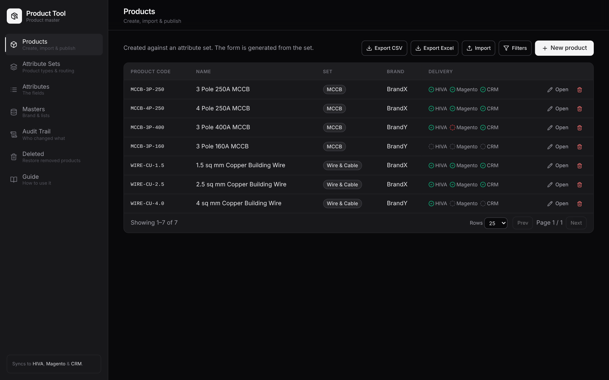
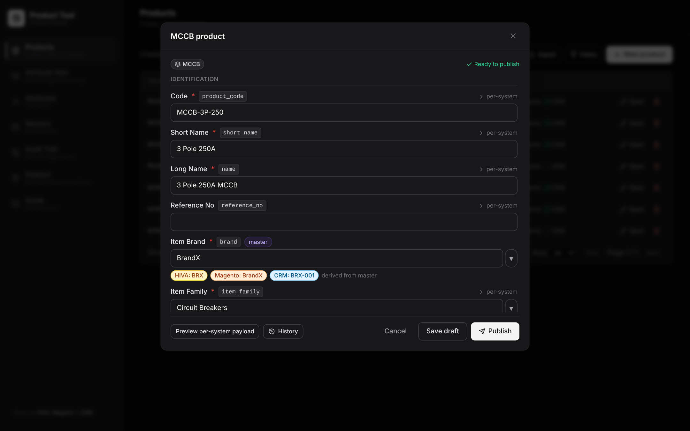
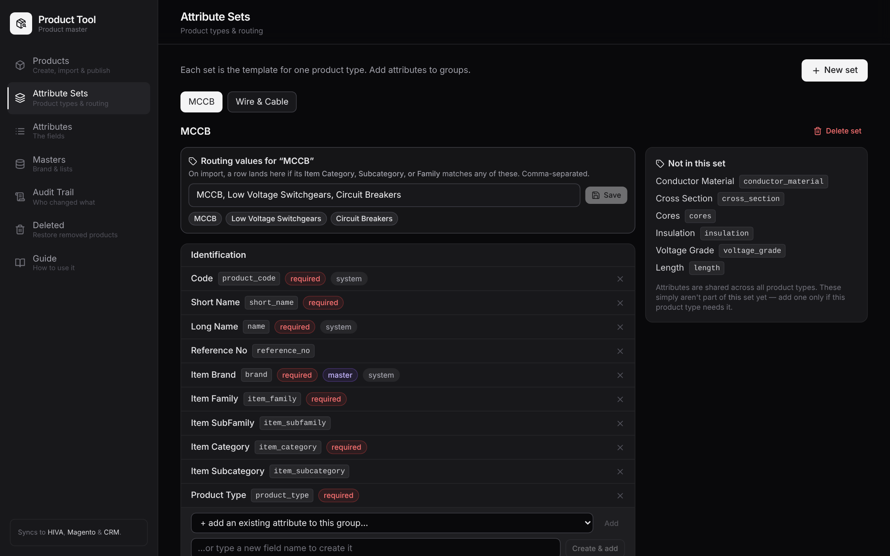
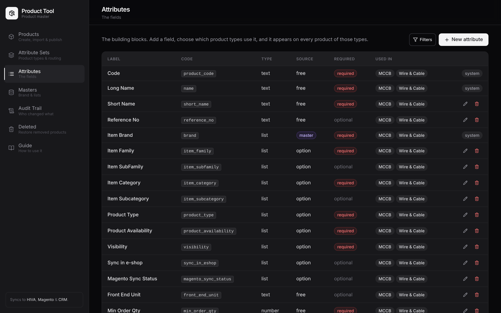
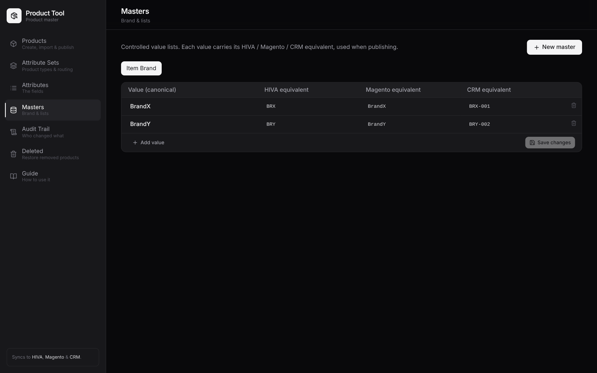
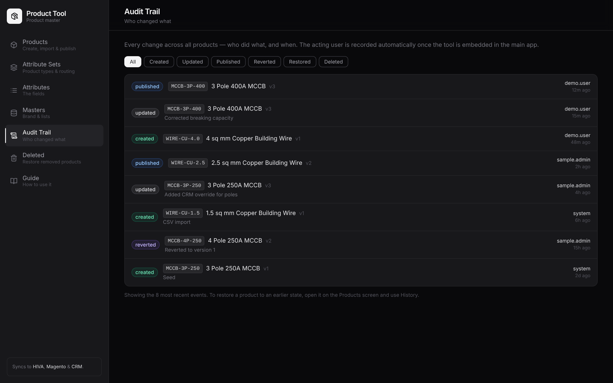
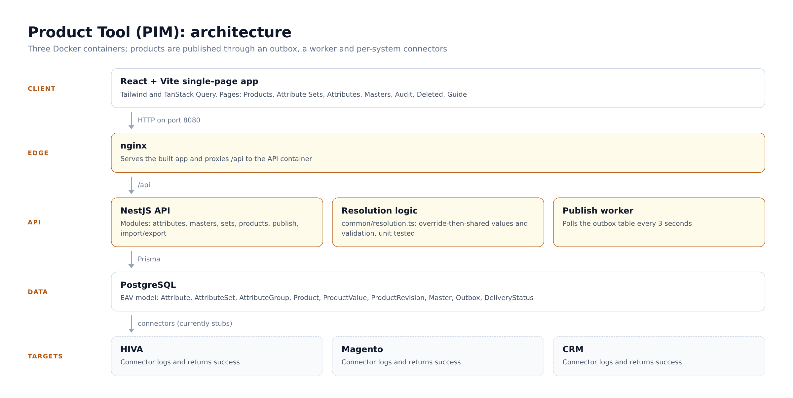
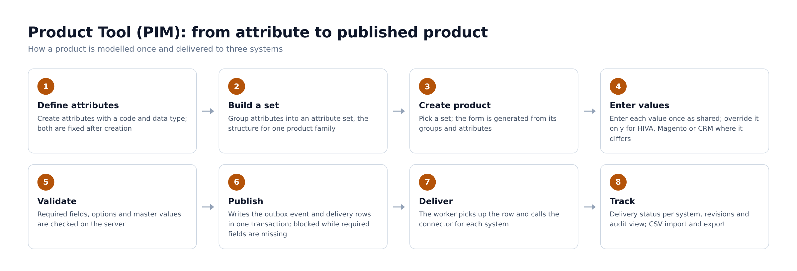

# Product Tool: Product Information Management (PIM)

A Product Information Management tool for an electrical-products catalogue (MCCBs, wire and cable, and similar), built at Eleczo India Pvt. Ltd. Product data is defined once and published to three systems, HIVA, Magento and CRM, each of which may need slightly different values.

> **Showcase repository.** This repo contains documentation only. The source code is private because it belongs to my employer. Screenshots use sample data and sample brand names.

## Screenshots

**Products.** Every product with its attribute set, brand and delivery status per system (HIVA, Magento, CRM), plus CSV and Excel export and import.

**Product editor.** The form is generated from the product's attribute set. Brand comes from a master, and the per-system values are derived from it. A product can be previewed per system, saved as a draft, or published.

**Attribute sets and attributes.** A set is the template for one product type. Attributes are shared building blocks that can be added to any set.

  
  

**Masters and audit trail.** Controlled value lists carry their HIVA, Magento and CRM equivalents. The audit trail records who changed what, and when.

  
  

## At a glance

| | |
|---|---|
| **Type** | Full-stack internal web application |
| **Frontend** | React, TypeScript, Vite, Tailwind CSS, TanStack Query |
| **Backend** | NestJS, TypeScript, Prisma |
| **Database** | PostgreSQL |
| **Publishing** | Transactional outbox, polling worker, per-system connectors |
| **Deployment** | Docker Compose: database, API and web (nginx) |

## The problem

The same product lived in three systems with three sets of field names and values, maintained separately. Adding a new product family meant changing each system by hand, and the data drifted apart. The goal was one place to define product structures and values, with a controlled way to push them out.

## What I built

- **Attributes.** Typed fields with options. An attribute's code and data type cannot be changed after creation.
- **Attribute sets.** A set is the structure for one product family, made of groups of attributes, in the style of Magento's EAV model. Routing values send imported rows to the right set.
- **Products.** A product is created against a set, and its form is generated from that set.
- **Three value sets per product.** A value is entered once as shared and overridden only for the system where it differs.
- **Masters.** Brand and module are master-backed, with the per-system value coming from the master.
- **Publishing.** Single and bulk publish, with delivery status per system.
- **Import and export.** CSV export of products and CSV import.
- **Audit trail, Deleted products (restorable) and version history**, plus an in-app Guide with annotated screenshots.

## Architecture

## How it works

## Technical highlights

- **EAV data model.** Attributes, sets, groups and values are rows, not columns, so a new product family needs no schema change.
- **Override-then-shared resolution.** The logic that decides which value each system receives is a pure module covered by a 12-case unit test, and mirrored on the frontend, where the product editor uses it to resolve and validate values.
- **Rules enforced on the server.** System attributes (`product_code`, `name`, `brand`, `module`) are present in every set and cannot be removed. Publishing is blocked while required fields are missing.
- **Transactional outbox.** A publish writes the outbox event and the per-system delivery rows in one transaction. A worker polls the outbox every 3 seconds and calls the connectors, so a failed delivery does not lose the change.
- **Clear plug-points.** Connectors, the message transport and authentication are isolated so real HIVA, Magento and CRM clients, RabbitMQ and SSO can replace the stubs without touching the core.
- **One-command start.** `docker compose up --build` creates the schema, seeds sample data and serves the app.

## Known limitations and next steps

- The three connectors are stubs that log and return success. Real clients still need to be written.
- No authentication is wired in yet; the planned route is a Keycloak/OIDC guard in NestJS.
- The worker polls the database. For production volumes this would move to a message queue.

## Skills demonstrated

TypeScript across the stack, NestJS module design, Prisma and PostgreSQL data modelling (EAV), the outbox pattern, React with TanStack Query, dynamic form generation, CSV import and export, Docker Compose and nginx.

## Contact

- Email: deepatil0212@gmail.com
- LinkedIn: [linkedin.com/in/deepa-patil-332925345](https://www.linkedin.com/in/deepa-patil-332925345)
